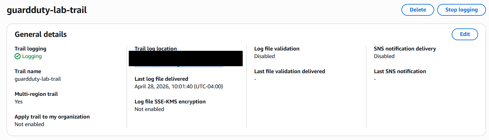
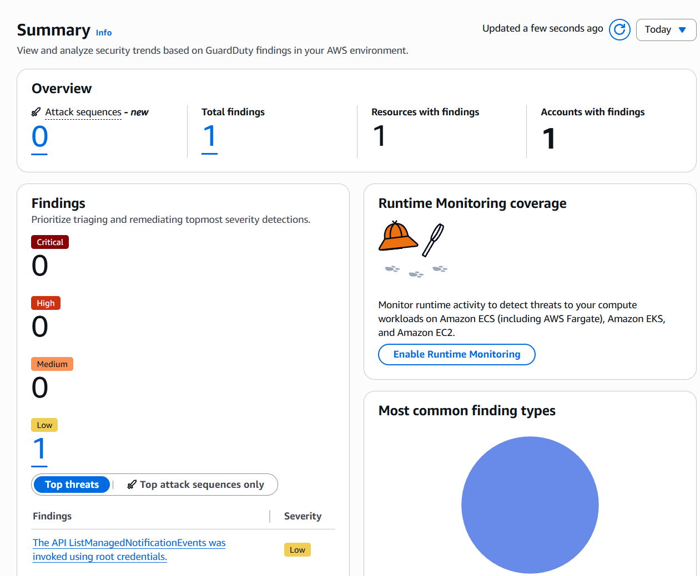
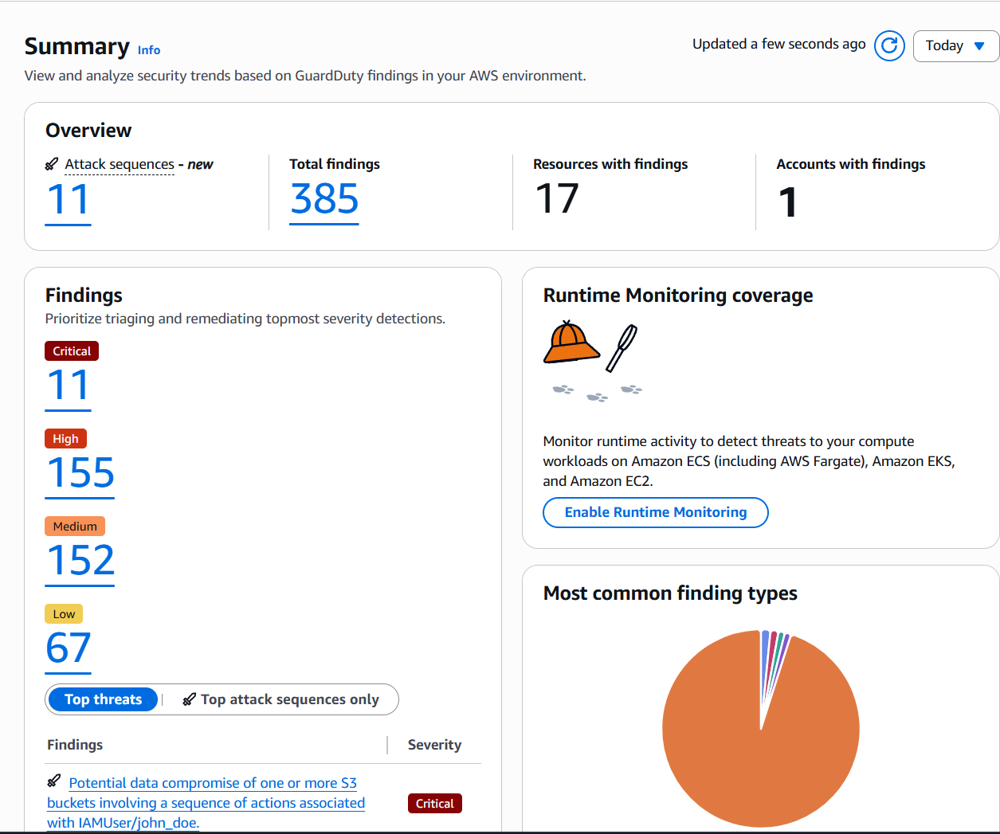
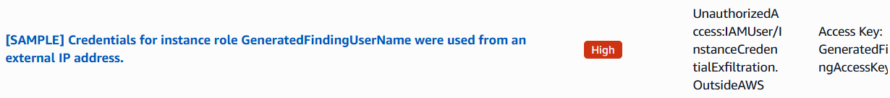
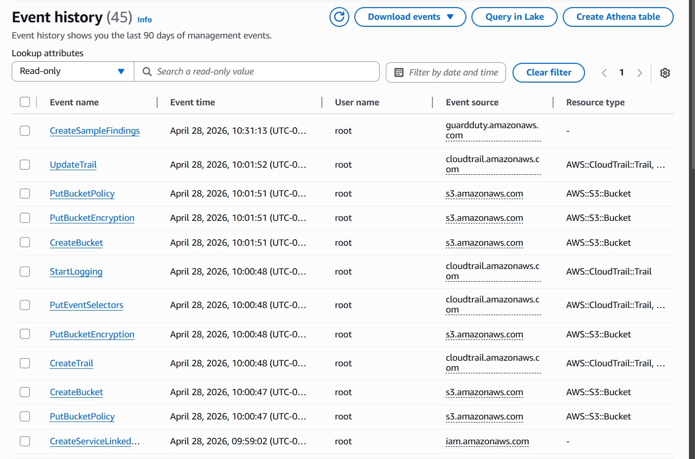
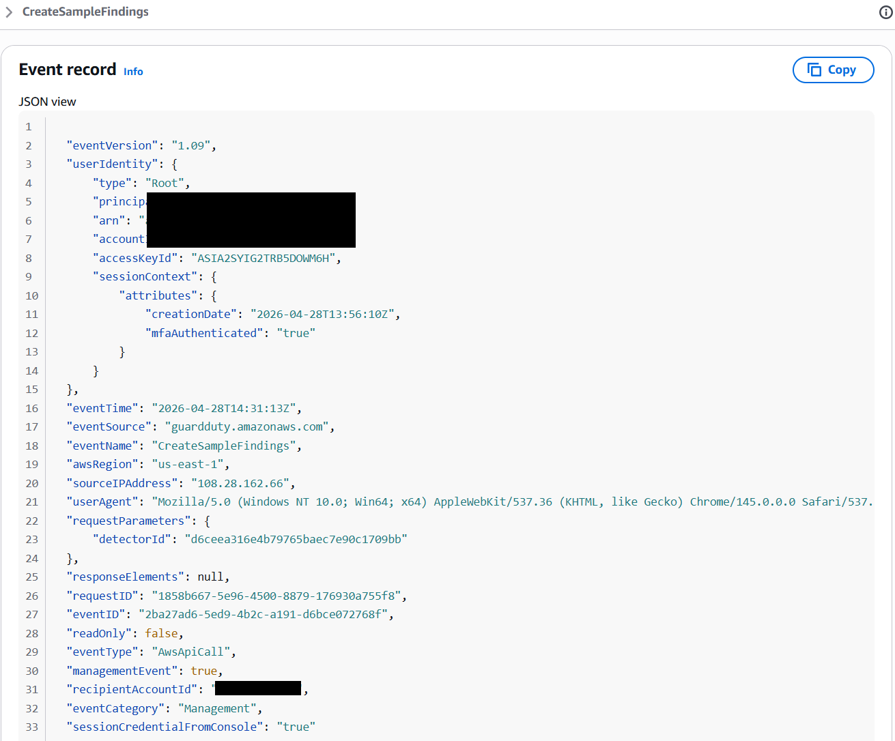
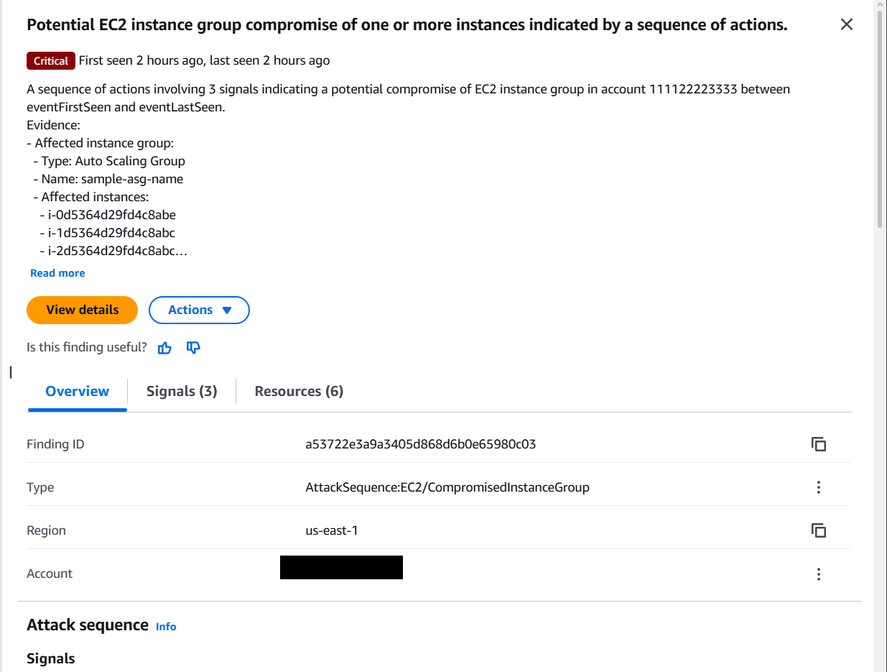
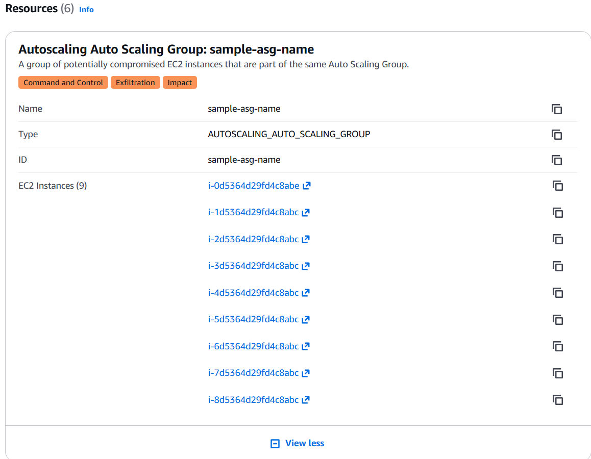
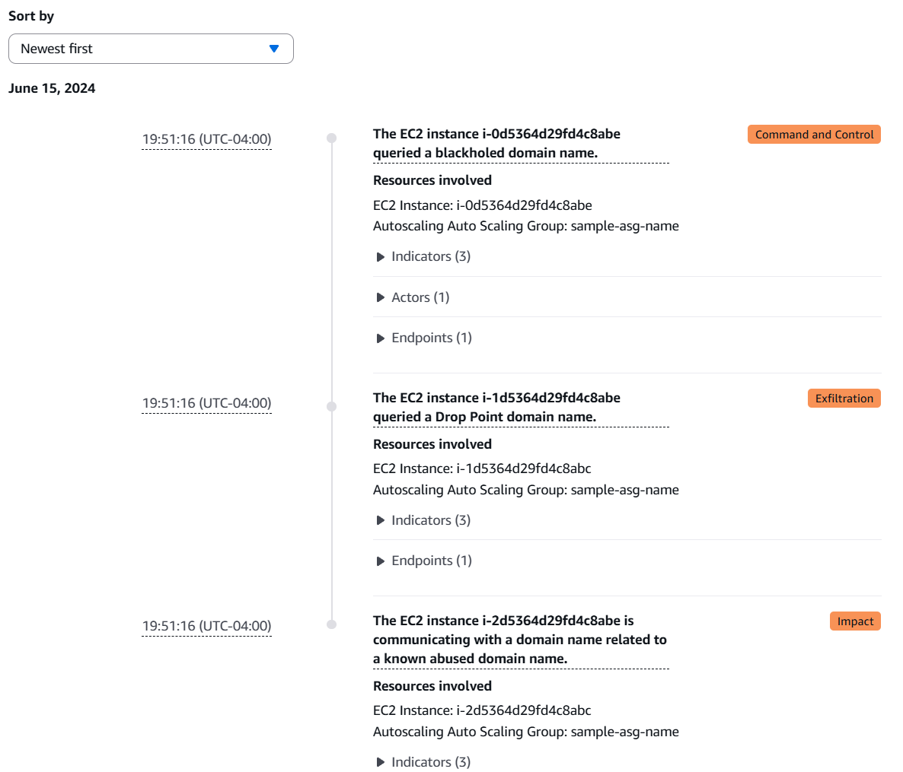

# AWS GuardDuty Threat Detection Lab


**Domain:** Cloud security, threat detection, incident investigation
**Tools:** Amazon GuardDuty · AWS CloudTrail · AWS S3 · AWS Console
**Date completed:** April 28, 2026

Full write-up: [`docs/aws-guardduty-incident-report.pdf`](docs/aws-guardduty-incident-report.pdf)

---

## Project Overview

This project demonstrates cloud threat detection and incident investigation using Amazon GuardDuty and AWS CloudTrail in a personal AWS lab environment. The goal was to simulate realistic cloud attack scenarios, investigate the findings the way a SOC analyst would, and produce a formal incident report as a portfolio deliverable.

GuardDuty was enabled on a personal AWS account, CloudTrail was configured to capture a full management-event audit trail, and sample findings were generated to simulate two distinct threat scenarios. Each finding was investigated by examining its GuardDuty detail, cross-referencing CloudTrail event history, and documenting analyst conclusions and recommended response actions.

---

## What Was Investigated

### Finding 1 — Credential Exfiltration (High severity)

**Type:** `UnauthorizedAccess:IAMUser/InstanceCredentialExfiltration.OutsideAWS`

EC2 instance credentials were detected being used from an external IP address outside the instance — a strong indicator that temporary AWS credentials were stolen and are being used by a threat actor from outside AWS infrastructure. Maps to MITRE ATT&CK T1552.005 (Cloud Instance Metadata API).

Investigation included analyzing the actor IP address, identifying the affected resource, cross-referencing CloudTrail for corroborating API call evidence, and documenting a full incident response playbook.

### Finding 2 — EC2 Instance Group Compromise (Critical severity)

**Type:** `AttackSequence:EC2/CompromisedInstanceGroup`

GuardDuty's correlation engine detected three signals across nine EC2 instances in an Auto Scaling Group, identifying them as a coordinated multi-stage attack chain — GuardDuty's most advanced detection capability, correlating separate events across time and resources rather than flagging individual anomalies.

| Signal | Tactic | Observed behavior |
|---|---|---|
| 1 | Command & Control | Instance queried a blackholed C2 domain |
| 2 | Exfiltration | Instance queried a drop-point data collection domain |
| 3 | Impact | Instance communicating with a known abused domain |

---

## Findings Summary (from the GuardDuty dashboard)

| Severity | Count |
|---|---|
| Critical | 11 |
| High | 155 |
| Medium | 152 |
| Low | 67 |
| **Total** | **385** |

385 findings across 17 resources in 1 account, all generated with GuardDuty's built-in sample findings generator rather than a live attack.

---

## Skills Demonstrated

Enabling and configuring Amazon GuardDuty for continuous cloud threat monitoring, configuring AWS CloudTrail for management-event audit logging, reading and triaging GuardDuty findings by severity and type, cross-referencing GuardDuty findings against CloudTrail event history, identifying and documenting false positives with supporting context, MITRE ATT&CK tactic mapping for cloud-based attack techniques, and formal incident report writing for both technical and executive audiences.

---

## Tools Used

| Tool | Purpose |
|---|---|
| Amazon GuardDuty | Continuous threat detection, ingests VPC Flow Logs, CloudTrail, and DNS logs |
| AWS CloudTrail | Management-event audit trail, raw API call logging |
| AWS S3 | CloudTrail log storage |
| AWS Console | Lab configuration, finding investigation, event history analysis |

---

## Screenshots

| # | Screenshot | What it shows |
|---|---|---|
| 01 |  | CloudTrail trail active and logging |
| 02 |  | A low-severity finding identified as a false positive |
| 03 |  | GuardDuty summary: 385 findings across 17 resources |
| 04 |  | High-severity credential exfiltration finding |
| 05 |  | CloudTrail event history log |
| 06 |  | CloudTrail JSON event record for the sample-findings API call |
| 07 |  | Critical EC2 instance group compromise finding |
| 08 |  | Auto Scaling Group resources affected by the finding |
| 09 |  | The three correlated attack signals behind the critical finding |

---

## Key Takeaways

GuardDuty is an agentless detection service — no software is installed on monitored instances. It detects; CloudTrail explains. Together they form the foundation of cloud incident investigation in AWS.

The `AttackSequence` finding type showed how ML-based correlation across multiple signals can identify sophisticated, multi-stage attacks that individual signature-based rules would miss — a capability that matters more as threat actors adopt more advanced cloud-native techniques.

False positive triage is as important as detection. A low-severity finding triggered by legitimate administrative activity (CloudTrail trail creation) was correctly identified and closed with CloudTrail context, which shows that alert investigation needs environmental awareness, not just tool output.

---

## Repository Layout

```
.
├── README.md
├── docs/
│   └── aws-guardduty-incident-report.pdf
└── screenshots/
```

---

## Notes

- All findings were generated using GuardDuty's built-in sample findings generator in a personal sandbox account. No live infrastructure was attacked or compromised.
- The AWS account ID is blacked out in every screenshot that showed it (01, 06, 07). It wasn't masked in the originally uploaded images; this version fixes that.
- GuardDuty was disabled after the lab to avoid post-trial charges.

---

## Related Projects

- [Security Onion Home Lab: Detection & Incident Response](https://github.com/MrBSykes/security-onion-home-lab-detection-incident-response)
- [Active Directory Home Lab: Phase 2, Attack Simulation & Detection](https://github.com/MrBSykes/active-directory-home-lab-phase-2-attack-simulation-and-detection)

---

*Bryan Sykes | Home Lab Portfolio | 2026*
